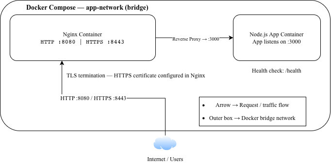
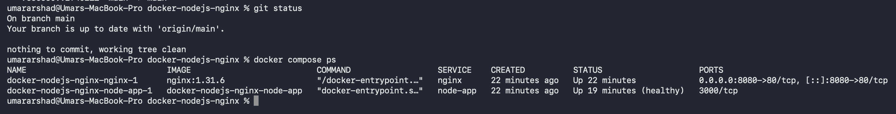
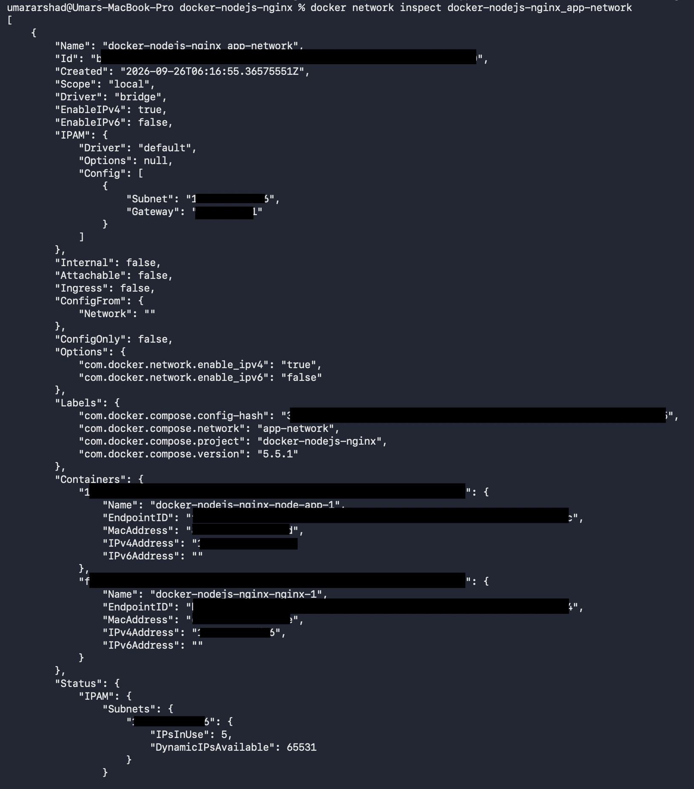
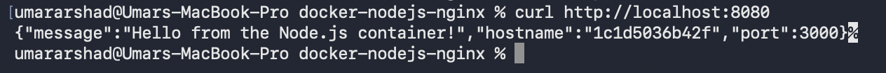
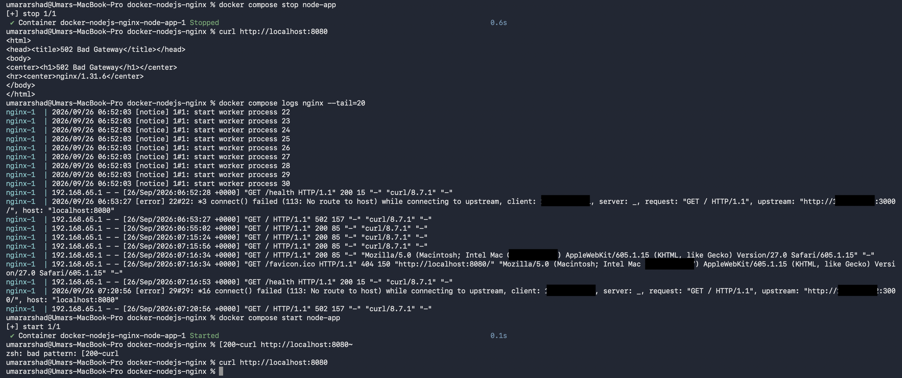

# Dockerized Node.js Application Behind Nginx

A containerized Node.js application deployed behind an Nginx reverse proxy using Docker Compose.

This project demonstrates Docker image creation, container networking, service-to-service communication, health checks, reverse proxying, port exposure, persistent volumes, and container troubleshooting.

## Architecture Diagram



## Architecture

```text
                    Browser
                       |
                       | http://localhost:8080
                       v
              +------------------+
              |      Nginx       |
              | Reverse Proxy    |
              |    Port 80       |
              +--------+---------+
                       |
                       | Docker network
                       | node-app:3000
                       v
              +------------------+
              |     Node.js      |
              |     Express      |
              |    Port 3000     |
              +------------------+
```

### Request Flow

1. The browser sends a request to `localhost:8080`.
2. Docker forwards host port `8080` to port `80` inside the Nginx container.
3. Nginx receives the request.
4. Nginx forwards the request to the `node-app` service on port `3000`.
5. Docker's internal DNS resolves `node-app` to the Node.js container.
6. Node.js processes the request.
7. Nginx returns the response to the browser.

## Technologies

* Docker
* Docker Compose
* Node.js
* Express
* Nginx
* Docker bridge networking
* Docker health checks

## Project Structure

```text
docker-nodejs-nginx/
├── app/
│   ├── app.js
│   └── package.json
├── nginx/
│   └── nginx.conf
├── Dockerfile
├── docker-compose.yml
├── .dockerignore
├── .gitignore
└── README.md
```
## Screenshots

The following screenshots demonstrate the Docker Compose services, container networking, application access, and troubleshooting workflow.

### Container Status



### Docker Network Configuration



### Application Access



### Troubleshooting




## Docker Concepts Demonstrated

### Dockerfile

The `Dockerfile` builds the Node.js application image using the official Alpine-based Node.js image.

Node.js and npm run inside the container, so the application runtime does not need to be installed directly on the host machine.

### Image vs Container

A Docker image is the packaged template containing the application and its runtime environment.

A container is a running instance created from that image.

### Docker Networking

The Nginx and Node.js containers communicate through a dedicated Docker bridge network:

```text
app-network
```

Nginx reaches the Node.js application using the Docker Compose service name:

```text
node-app:3000
```

The configuration does not depend on manually assigned container IP addresses.

### Port Exposure

Only Nginx publishes a port to the host:

```text
localhost:8080 → nginx:80
```

The Node.js application listens on port `3000` internally.

Therefore, users access the application through Nginx rather than directly accessing the Node.js container.

## Health Check

The Node.js application provides a health endpoint:

```text
GET /health
```

Expected response:

```json
{
  "status": "ok"
}
```

Docker Compose uses this endpoint to determine whether the Node.js service is healthy.

Nginx is configured with:

```yaml
depends_on:
  node-app:
    condition: service_healthy
```

This causes the Nginx service to wait until the Node.js service passes its health check before starting.

## Running the Project

### Prerequisites

Install:

* Docker Desktop
* Docker Compose

Verify the installation:

```bash
docker --version
docker compose version
```

### Start the Application

Clone the repository and enter the project directory:

```bash
git clone https://github.com/UmarArshad3/docker-nodejs-nginx.git
cd docker-nodejs-nginx
```

Build the image and start the services:

```bash
docker compose up -d --build
```

Check the services:

```bash
docker compose ps
```

The Node.js service should show a healthy status.

### Test the Application

Open the application in a browser:

```text
http://localhost:8080
```

Or use curl:

```bash
curl http://localhost:8080
```

Example response:

```json
{
  "message": "Hello from the Node.js container!",
  "hostname": "container-id",
  "port": 3000
}
```

Test the health endpoint:

```bash
curl http://localhost:8080/health
```

Expected response:

```json
{
  "status": "ok"
}
```

## Troubleshooting

### Nginx Returns 502 Bad Gateway

A `502 Bad Gateway` can occur when Nginx cannot reach its upstream Node.js application.

First check the service status:

```bash
docker compose ps
```

Check Nginx logs:

```bash
docker compose logs nginx --tail=20
```

Check Node.js logs:

```bash
docker compose logs node-app
```

If the Node.js service is stopped, start it:

```bash
docker compose start node-app
```

Then test the application again:

```bash
curl http://localhost:8080
```

### Example Troubleshooting Scenario

During testing, the Node.js container was intentionally stopped while Nginx remained running.

The request:

```bash
curl http://localhost:8080
```

returned:

```text
502 Bad Gateway
```

Nginx logs showed that the upstream Node.js service was unreachable.

The issue was diagnosed using:

```bash
docker compose ps
docker compose logs nginx --tail=20
```

The Node.js service was then restored:

```bash
docker compose start node-app
```

The application returned successfully again.

This demonstrates a basic troubleshooting workflow:

```text
502 Bad Gateway
       ↓
Check service status
       ↓
Check reverse-proxy logs
       ↓
Identify unavailable upstream
       ↓
Recover affected service
       ↓
Verify end-to-end request
```

## Useful Docker Commands

Check running services:

```bash
docker compose ps
```

View all logs:

```bash
docker compose logs
```

View Nginx logs:

```bash
docker compose logs nginx
```

View Node.js logs:

```bash
docker compose logs node-app
```

Follow logs in real time:

```bash
docker compose logs -f
```

Validate the Compose configuration:

```bash
docker compose config
```

Stop and remove the services:

```bash
docker compose down
```

Rebuild the application:

```bash
docker compose up -d --build
```

## Persistence and Volumes

Docker volumes were also tested separately to understand container persistence.

A container's writable filesystem is tied to that container. Data stored in a named Docker volume can survive the deletion of the container.

This distinction is important for stateful workloads such as:

* Databases
* Uploaded files
* Application-generated persistent data

The Node.js application in this project is stateless, so it does not require a persistent volume.

## Security Considerations

The Node.js application is kept behind the Nginx reverse proxy.

Only Nginx publishes a host port:

```text
8080 → 80
```

The Node.js port remains internal to the Docker network.

The repository also excludes sensitive files such as:

```text
*.pem
.env
.env.*
```

through `.gitignore`.

## Lessons Learned

This project provided hands-on experience with:

* Building Docker images
* Running containers
* Docker port mapping
* Docker bridge networks
* Container-to-container communication
* Docker DNS and service names
* Nginx reverse proxying
* Docker Compose
* Health checks
* Compose service dependencies
* Docker volumes and persistence
* Container troubleshooting
* Diagnosing HTTP 502 errors
* Git and GitHub workflow
* Keeping secrets and unnecessary files out of source control

## Future Improvements

Possible extensions include:

* HTTPS/TLS with Nginx
* Environment-based configuration
* Production-grade Nginx configuration
* Docker image optimization
* CI/CD with GitHub Actions
* Deployment to AWS
* Terraform infrastructure as code
* Container monitoring and logging
* Kubernetes deployment
